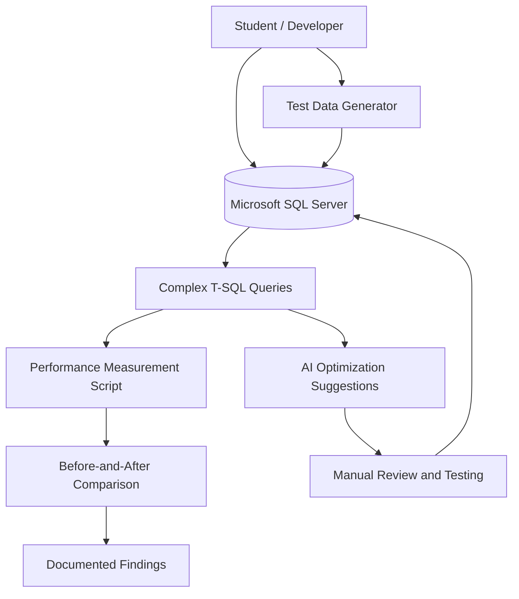

# EV Charging Network Database with AI-Supported Performance Optimization

## 1. Operators and permissions

| Role | Needs | Responsibility / access |
|---|---|---|
| Charging network operator | Analyse charging activity, energy consumption, revenue, and faults | Uses SQL queries to retrieve operational information |
| Student / database developer | Build and optimize the database | Designs tables, generates test data, develops queries, and measures performance |
| AI service | Suggest query and indexing optimizations | Provides suggestions that the student reviews and tests |

A complete user-facing application with separate login accounts and permission screens is not required.

## 2. Use cases / user stories

### Manage and analyse charging data

- **Operator:** Charging network operator / student
- **Precondition:** The database contains valid charging-network data.
- **Main flow:**
  1. The operator selects a business question, such as identifying the most frequently used charging stations.
  2. The corresponding SQL query is executed.
  3. SQL Server retrieves and processes the relevant records.
  4. The results show information such as energy consumption, revenue, or charging activity.
- **Alternative / error flows:** Invalid queries or database errors are reported.
- **Postcondition:** The requested analytical results are available.

### Measure and optimize query performance

- **Operator:** Student / database developer
- **Precondition:** The database contains the required test data and the selected query returns correct results.
- **Main flow:**
  1. Execute the query and record its baseline performance.
  2. Inspect the SQL Server execution plan and relevant statistics.
  3. Apply an optimization, such as adding an index or rewriting the query.
  4. Execute the query again and record the results.
  5. Compare execution times, execution plans, and relevant statistics.
- **Alternative / error flows:** If an optimization produces incorrect results or reduces performance, revise or reject it.
- **Postcondition:** The optimization attempt and its measured effects are documented.

### Evaluate AI optimization suggestions

- **Operator:** Student / AI service
- **Precondition:** A selected query and its baseline measurements are available.
- **Main flow:**
  1. Submit the query and relevant schema information to an AI service.
  2. Obtain suggestions for query rewriting or indexing.
  3. Review the suggestions for correctness, compatibility, and safety.
  4. Test approved suggestions manually in SQL Server.
  5. Compare their performance with the student's own solutions.
- **Alternative / error flows:** Incorrect, unsafe, or ineffective suggestions are rejected.
- **Postcondition:** AI suggestions are evaluated using correctness checks and actual measurements.

## 3. Functional requirements

| Requirement | Acceptance criteria | Priority |
|---|---|---|
| Manage charging-network data | The database stores stations, charging points, users, vehicles, reservations, sessions, measurements, tariffs, payments, and technical events. | Must |
| Maintain database integrity | At least 10 related tables are implemented, targeting 3NF, with appropriate keys, relationships, and business constraints. | Must |
| Generate test data | A reproducible generator creates at least 100,000 charging sessions and 1,000,000 timestamped measurement or status records. | Must |
| Develop complex SQL queries | At least 10 queries use multi-table joins, aggregation, time-interval searches, subqueries or CTEs, and window functions across the query set. | Must |
| Implement business logic | At least one stored procedure or function is implemented using T-SQL. A trigger is added where justified. | Must |
| Analyse query performance | At least five queries have documented baseline execution plans and performance measurements. | Must |
| Optimize queries | At least two indexing or query optimization approaches are compared using execution times and execution plans. | Must |
| Automate measurements | A custom script or application component records reproducible performance comparisons before and after optimization. | Must |
| Evaluate AI suggestions | At least three queries receive AI-generated optimization suggestions, checked for correctness, executability, and measured performance. | Must |
| Document AI security | The project documents the risks of sharing information with external AI services and requires manual review before execution. | Must |

**Priority:** Must = required for completion.

## 4. Business rules and constraints

| Rule or constraint | Rationale |
|---|---|
| Every major entity must have a primary key, and relationships must use foreign keys. | Maintains unique records and valid relationships. |
| The database must target at least Third Normal Form (3NF). | Reduces unnecessary data duplication. |
| Charging sessions and reservations must reference valid related records. | Prevents invalid relationships. |
| Reservation time intervals and measurement values must satisfy defined validation rules. | Prevents invalid data. |
| Energy consumption and monetary amounts must follow appropriate validation rules. | Supports reliable analysis and calculations. |
| Test data and performance measurements must be reproducible. | Allows experiments to be repeated and compared. |
| Optimizations must preserve query correctness. | Ensures performance improvements do not change the intended results. |
| AI-generated SQL and database definition statements must be reviewed before execution. | Prevents unsafe or incorrect database changes. |
| Sensitive data must not be shared with external AI services. | Protects privacy and confidentiality. |

## 5. User interface and workflow

A complex web interface is not required. The project will primarily use SQL Server Management Studio (SSMS), SQL scripts, and a custom measurement script.

The workflow is:

1. Design and create the database in Microsoft SQL Server.
2. Generate the required synthetic test data.
3. Develop and execute at least 10 complex SQL queries.
4. Measure the baseline performance of at least five queries.
5. Apply and test indexing and query optimization techniques.
6. Obtain and evaluate AI suggestions for at least three queries.
7. Compare the results and document the findings.

## 6. Non-functional requirements

| Requirement | How it will be verified |
|---|---|
| Database reliability | Test primary keys, foreign keys, constraints, and relationships in SQL Server. |
| Data volume | Verify at least 100,000 charging sessions and 1,000,000 timestamped measurement/status records. |
| Reproducibility | Repeat data generation and performance measurements using documented procedures. |
| Query correctness | Compare the result sets of original and optimized queries. |
| Performance evaluation | Record execution times, Actual Execution Plans, and relevant performance statistics. |
| Native performance tools | Use Actual Execution Plan, `SET STATISTICS IO`, and `SET STATISTICS TIME`; use Query Store where appropriate. |
| Version control | Store database scripts, generator code, and measurement scripts in Git. |
| AI safety | Verify that suggestions are reviewed before execution and sensitive data is excluded from external prompts. |

Performance improvements will be evaluated using actual measurements. The project does not assume that every index or query rewrite will improve execution time.

## 7. Open questions and risks

| Question / risk | Impact | Resolution |
|---|---|---|
| Can SQL Server handle the required dataset? | Affects setup time and storage requirements. | Generate a smaller test dataset first, then scale up and verify record counts. |
| Will the synthetic data resemble realistic charging activity? | Unrealistic distributions may produce misleading results. | Document generation assumptions and create plausible relationships and timestamps. |
| Will indexes improve query performance? | Some indexes may not help and can add storage or write overhead. | Compare execution plans, execution times, and logical reads. |
| Will AI suggestions be correct and effective? | Suggestions may be incompatible, incorrect, or slower. | Review, test, and measure every selected suggestion. |
| Can experiments be reproduced? | Different conditions can affect performance measurements. | Document the environment and repeat measurements under comparable conditions. |
| Could external AI use expose sensitive data? | May create privacy or confidentiality risks. | Use synthetic data and share only the schema and query details needed. |

## 8. Initial technical specification proposal

### Proposed solution

The project will implement a relational database for an electric vehicle charging network using Microsoft SQL Server and T-SQL. It will manage charging stations, charging points, users, vehicles, reservations, charging sessions, energy measurements, tariffs, payments, and technical events.

The database will contain at least 10 related tables designed to at least Third Normal Form (3NF). A custom script or application component will generate the required synthetic data and automate performance measurements.

At least 10 complex SQL queries will be developed. At least five will undergo detailed performance analysis. The project will test indexing and query optimization approaches using SQL Server execution plans and performance statistics.

An AI service will provide optimization suggestions for at least three selected queries. Each suggestion will be reviewed and tested manually, then compared with the student's own solutions. AI-generated statements will not be executed automatically without review.

### Technology direction

| Area | Technology / approach | Purpose |
|---|---|---|
| Database | Microsoft SQL Server | Store and manage charging-network data |
| Query and procedural language | SQL and T-SQL | Query data and implement business logic |
| Database development tools | SQL Server Management Studio (SSMS) | Create database objects, execute queries, and inspect plans |
| Indexing | Simple, composite, and filtered indexes where appropriate | Test alternative access paths and improve query performance |
| Test-data generation | Custom script or application component | Generate large, reproducible datasets |
| Performance measurement | Custom script or application component | Record and compare query execution results |
| Performance analysis | Actual Execution Plan, `SET STATISTICS IO`, `SET STATISTICS TIME`, and Query Store where appropriate | Identify bottlenecks and evaluate optimizations |
| AI support | External LLM service, optionally through an API | Suggest and evaluate query optimizations |
| Version control | Git and GitHub | Track schema, SQL scripts, and project changes |

### Initial architecture sketch

### Feasibility and technical risks

| Risk / assumption | Validation | Fallback |
|---|---|---|
| SQL Server can handle the required dataset. | Generate and verify the required record counts. | Improve the generation process and use batch inserts. |
| The queries can be optimized. | Compare execution plans, execution times, and logical reads. | Test alternative indexes or query rewrites and document ineffective approaches. |
| AI suggestions are useful. | Test suggestions for at least three queries and compare results. | Document incorrect or ineffective suggestions and retain the best verified solution. |
| Performance experiments are reproducible. | Repeat tests under documented conditions. | Improve automation and record environmental limitations. |
